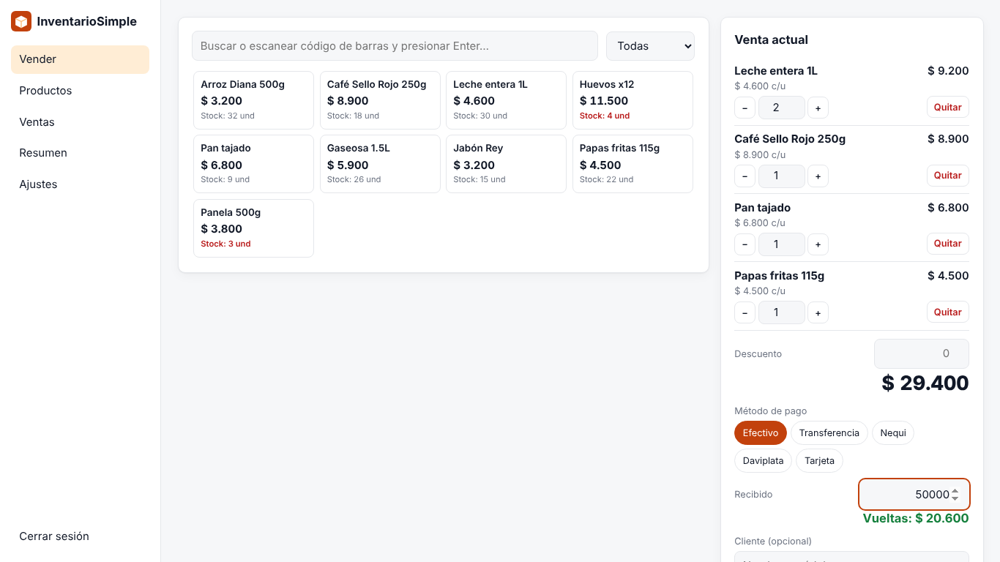
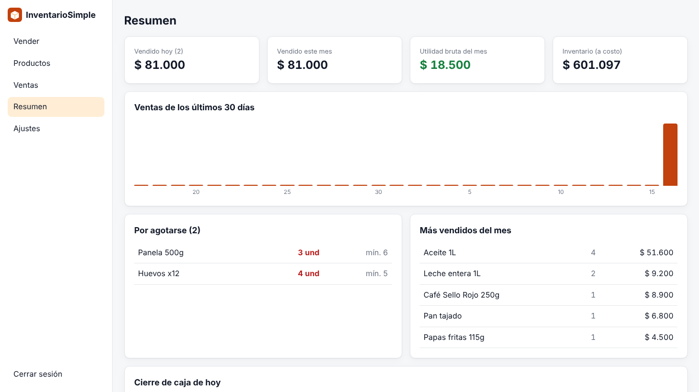

# InventarioSimple

Punto de venta e inventario para tiendas de barrio, minimercados, droguerías, papelerías, ferreterías y cualquier negocio que venda productos. En español, sin mensualidades y en tu propio servidor.

<!-- Cuando Hostinger abra su programa para desarrolladores, pega aquí el botón con tu código de referencia:
[](URL_DE_IMPLEMENTACIÓN_CON_TU_CÓDIGO)
-->



## Qué hace

- **Caja rápida:** busca productos o escanea el código de barras con un lector USB, que escribe el código y presiona Enter. Ajustas cantidades y aplicas descuentos.
- **Cobro con cualquier método:** efectivo con cálculo de vueltas, transferencia, Nequi, Daviplata o tarjeta. Los métodos se editan en Ajustes.
- **Comprobante** listo para imprimir en impresora térmica de 80 mm o en hoja normal.
- **Control de stock:** cada venta descuenta el inventario y no deja vender lo que no hay. Esto último se puede desactivar.
- **Entradas de mercancía** con **costo promedio ponderado** automático.
- **Ajustes y conteo físico:** escribes cuántas unidades contaste y la app registra la diferencia.
- **Kárdex por producto:** todos los movimientos con su saldo.
- **Anular ventas:** el stock vuelve al inventario y la venta queda marcada, no se borra.
- **Resumen:** ventas del día y del mes, utilidad bruta, valor del inventario, productos por agotarse, los más vendidos y el cierre de caja por método de pago.
- **Exportar a CSV** productos y ventas para Excel o tu contador.
- **Funciona en el celular** como caja, con una barra que muestra el total de la venta.
- **Copia de seguridad** y restauración en un clic.
- **Sin dependencias:** solo necesita Node.js 18 o superior. No usa base de datos externa.



> ⚠️ **Importante: no es factura electrónica.** El comprobante que imprime InventarioSimple es un soporte interno de la venta. **No es factura electrónica de venta ante la DIAN** ni ante otras autoridades tributarias. Si tu negocio está obligado a facturar electrónicamente, usa además un proveedor autorizado.

## Instalación

### Opción 1: Docker (recomendada, ideal para un VPS)

```bash
git clone https://github.com/Gestiiona/inventario-simple.git
cd inventario-simple
cp .env.example .env      # edita ADMIN_PASSWORD
docker compose up -d
```

Abre `http://IP-DE-TU-SERVIDOR:3000` y entra con la contraseña de `ADMIN_PASSWORD`.

### Opción 2: Node.js

```bash
git clone https://github.com/Gestiiona/inventario-simple.git
cd inventario-simple
ADMIN_PASSWORD="tu-contraseña-segura" npm start
```

### Primeros pasos

1. En **Ajustes**, escribe los datos de la tienda que saldrán en el comprobante.
2. En **Productos**, crea tus productos con precio, costo, código de barras, stock inicial y el mínimo para recibir alerta.
3. Abre **Vender** y empieza a cobrar.

### Variables de entorno

| Variable | Para qué sirve | Por defecto |
|---|---|---|
| `ADMIN_PASSWORD` | Contraseña de acceso (mínimo 8 caracteres). **Defínela siempre.** | — |
| `PORT` | Puerto del servidor | `3000` |
| `DATA_DIR` | Carpeta donde se guardan los datos | `./data` |
| `SETUP_CODE` | Código fijo para la configuración inicial, si no usas `ADMIN_PASSWORD` | aleatorio |

**Sin `ADMIN_PASSWORD`**, la primera pantalla pide un *código de configuración* que se imprime en los registros (logs) del servidor. Así nadie más puede adueñarse de tu instalación antes que tú.

## Tus datos

Todo se guarda en `data/db.json`.

- **Docker:** los datos viven en el volumen `inventariosimple-data` y sobreviven a reinicios y actualizaciones.
- **Hosting administrado (por ejemplo, Web Apps de Node.js):** comprueba que la carpeta de datos se conserve al volver a desplegar. Si no estás seguro, apunta `DATA_DIR` a una carpeta persistente o usa un VPS con Docker.
- **Haz copias de seguridad** desde *Ajustes → Descargar copia*, idealmente al cerrar cada día.
- Está pensado para **una tienda con una caja**. Si varias personas cobran al mismo tiempo desde distintos equipos funciona, pero todas comparten la misma contraseña.

## Seguridad

- Contraseña guardada con `scrypt` y sesión en una cookie firmada `HttpOnly`.
- Límite de intentos de acceso por IP.
- Las ventas se validan en el servidor: precios, stock y efectivo recibido.
- El CSV exportado neutraliza fórmulas para que una celda maliciosa no se ejecute en Excel.
- Usa HTTPS en producción. En un VPS puedes ponerlo detrás de Caddy, Nginx o Traefik.

## Actualizar

```bash
git pull
docker compose up -d --build
```

## Licencia

MIT. Úsala, modifícala y compártela libremente.

Hecho por [Gestiiona](https://gestiiona.com). Revisa también [FacturaSimple](https://github.com/Gestiiona/factura-simple), [AgendaSimple](https://github.com/Gestiiona/agenda-simple) y [VentasSimple](https://github.com/Gestiiona/ventas-simple).
